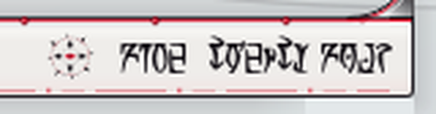
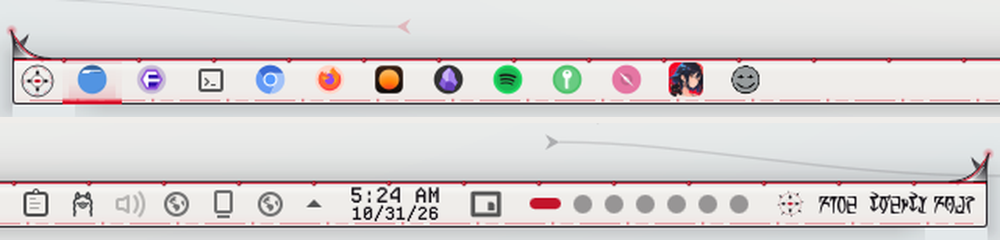

# Xenoglyph — Sigil Clock (Plasma Widget)

A small turning sigil for the panel that tells the time in Daedric words; hover to read it in Latin.



Xenoglyph is an alien-white, cybertribal look for KDE Plasma 6: pearl and bone surfaces, black tribal ink that sweeps into fins, horns and claws, a red ichor seam through everything, Daedric script, and motion everywhere.

## Features

- A miniature of the Xenoglyph sigil that slowly turns in the panel.
- The time spelled out in Daedric script beside it. Hover over it to read it in Latin.
- Fits horizontal and vertical panels.



## Requirements

Plasma 6. The OMW Ayembedt (Daedric) font, bundled in `fonts/` and installed by `install.sh`.

## Install

```bash
git clone https://github.com/numbpill3d/xenoglyph-sigil
cd xenoglyph-sigil && ./install.sh
```

Or from the KDE Store: Extract to `~/.local/share/plasma/plasmoids/`, install the Daedric font, then add **Xenoglyph Sigil** to a panel.

## The rest of the suite

| piece | repo |
|---|---|
| SDDM login | [xenoglyph-sddm](https://github.com/numbpill3d/xenoglyph-sddm) |
| Plymouth boot splash | [xenoglyph-plymouth](https://github.com/numbpill3d/xenoglyph-plymouth) |
| Global theme + splash screen | [xenoglyph-global](https://github.com/numbpill3d/xenoglyph-global) |
| Plasma style (panel, popups) | [xenoglyph-plasma](https://github.com/numbpill3d/xenoglyph-plasma) |
| Aurorae window decoration | [xenoglyph-aurorae](https://github.com/numbpill3d/xenoglyph-aurorae) |
| Floating runes (KWin script) | [xenoglyph-runes](https://github.com/numbpill3d/xenoglyph-runes) |
| Window open/close animation (KWin effect) | [xenoglyph-unfurl](https://github.com/numbpill3d/xenoglyph-unfurl) |
| Animated + still wallpaper | [xenoglyph-wallpaper](https://github.com/numbpill3d/xenoglyph-wallpaper) |
| Colour scheme | [xenoglyph-colors](https://github.com/numbpill3d/xenoglyph-colors) |
| Kvantum widget style | [xenoglyph-kvantum](https://github.com/numbpill3d/xenoglyph-kvantum) |
| Icon theme | [xenoglyph-icons](https://github.com/numbpill3d/xenoglyph-icons) |
| Konsole + kitty colours | [xenoglyph-konsole](https://github.com/numbpill3d/xenoglyph-konsole) |

Everything at once, with the generators: [xenoglyph](https://github.com/numbpill3d/xenoglyph).

## Tags

`xenoglyph` `kde` `kde-plasma` `plasma6` `light-theme` `white` `red` `cybertribal` `tribal` `alien` `daedric` `otherworldly` `animated` `plasmoid` `plasma-widget` `clock` `panel-widget` `daedric-clock`

## Credits and licence

By splicer scorn (voidrane). GPL-3.0-or-later.
Fonts: OMW Ayembedt (Daedric, SIL OFL 1.1) and Departure Mono by Helena Zhang (SIL OFL 1.1), bundled with their licences.
